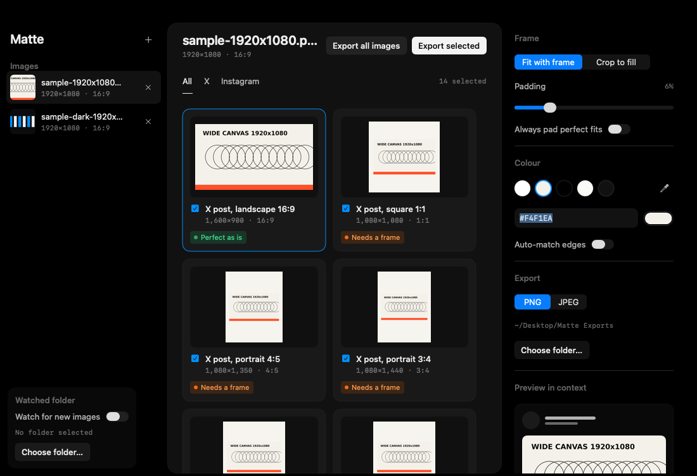

<p align="center">
  
</p>

<h1 align="center">Matte</h1>

<p align="center">Fit one design to every X and Instagram image format, without giving up control of the frame.</p>

Matte is a free, native macOS batch exporter for designers who work from a wide master canvas. It renders exact-pixel PNG or JPEG files for 13 current X and Instagram placements, with a frame, crop, custom colour, or automatically matched edge colour, and simulates how your images will actually be cropped once posted.




## Download

**[Download Matte.zip](https://github.com/max-pantom/matte/releases/latest/download/Matte.zip)** — universal Apple silicon and Intel build, macOS 14+.

1. Unzip and drag **Matte.app** into Applications.
2. Matte is ad-hoc signed but not notarized. If macOS blocks its first launch, use **System Settings › Privacy & Security › Open Anyway**, or run `xattr -dr com.apple.quarantine /Applications/Matte.app`.
3. Drop one or more images into the window, select the images and tick the formats you want, then export.

## Features

- 13 exact-size X and Instagram formats, including X's new multi-image carousel, header, Article cover, profile grid, and stories
- Selective export: multi-select images (click, ⌘-click, ⇧-click, ⌘A) and tick formats; Matte exports exactly *selected images × checked formats* and confirms before overwriting or writing large batches
- Post simulator: see your selected images as an X carousel, an Instagram carousel and an Instagram profile grid, with the crop percentage of every tile, for the originals or for Matte's framed export
- Fit with a frame or centre-crop to fill, with 0–30% padding
- White, off-white, black, paper grey and ink presets, recent colours, the system colour panel, an eyedropper, hex entry, and automatic edge-matched colours
- Previews render off the main thread from a downscaled copy and are cached; full resolution is decoded only for export, which runs in the background with progress and cancel
- Batch export to PNG or JPEG, with every written file re-read and pixel-verified. A single file (1 image × 1 format) is saved directly in the output folder; multi-file exports get one subfolder per image
- Optional watched folder (sidebar or Settings) that exports new stable image files automatically
- Native SwiftUI interface, no account, analytics, network access, or Xcode project

## Requirements

- macOS 14 or later
- Swift 6.0+ to build; Xcode Command Line Tools are sufficient

## Build and run

```sh
./build.sh
open Matte.app
```

`build.sh` prefers a universal arm64/x86_64 release build and falls back to the native architecture when a universal SDK is unavailable. It assembles and ad-hoc signs `Matte.app`; `ZIP=1 ./build.sh` also creates `Matte.zip`.

The headless exporter uses the same rendering core:

```sh
swift run -c release matte-cli samples/sample-1920x1080.png \
  --out out/example --formats all --pad 0.06 --mode fit --color auto
```

Run `swift run matte-cli --list` for the full format table.

Export options (all optional; `swift run matte-cli --help` lists them and which file types this Mac can write):

```sh
swift run -c release matte-cli samples/sample-1920x1080.png --out out/web \
  --formats x-landscape,ig-feed-45 --type webp --quality 85 --scale 2x \
  --name "{name}_{format}_{w}x{h}" --override ig-feed-45:pad=0.1,mode=fill \
  --colorspace p3 --max-size 5MB
```

| Flag | Meaning |
| --- | --- |
| `--type png\|jpeg\|heic\|webp` | File type (default `png`; `--jpeg` still works). HEIC/WebP need a system encoder; when it is missing Matte writes PNG and warns. |
| `--quality 0-100` | JPEG/HEIC/WebP quality (default 92). |
| `--scale 1x\|2x\|max:N` | `2x` doubles each format's pixel size; `max:N` caps the long edge at N px, keeping the ratio (never upscales). |
| `--name "<pattern>"` | Tokens `{name}` `{format}` `{w}` `{h}` `{ratio}` `{date}` `{index}`; default `{name}__{format}_{w}x{h}`. Names are sanitised and existing files get `-2`, `-3`… (`--overwrite` replaces them instead). |
| `--override id:pad=0.1,mode=fill` | Per-format padding and/or mode. Repeatable. |
| `--colorspace srgb\|p3` | Output colour space (default sRGB). |
| `--keep-metadata` | Copy the source's EXIF/TIFF/IPTC (never GPS; orientation reset). Stripped by default. |
| `--max-size 5MB` | Byte cap (`B`/`KB`/`MB`, decimal). Lossy types lower quality, down to 40, to fit; PNG warns, or writes JPEG with `--allow-lossy-fallback`. `--platform-caps` uses X 5 MB / Instagram 8 MB instead. |

Each written file is printed with its path, pixel size, byte size and any warnings. `swift run matte-cli --selftest` checks every file type, scaling, filename patterns, size caps and metadata handling in a temporary folder.

`--simulate` prints how a set of images (in posting order) is cropped by X and Instagram, using the same maths as the app's simulator:

```sh
swift run -c release matte-cli --simulate samples/sample-1920x1080.png samples/sample-dark-1920x1080.png
```

The icon source is `Resources/AppIcon-source.png` (1024×1024, transparent). `scripts/make-icon.sh` builds all 10 iconset sizes with `sips` and the `.icns` with `iconutil`; `build.sh` runs it when `Icon/AppIcon.icns` is missing or older than the source.

## How it works

Matte decodes each source with ImageIO and renders directly into an sRGB CoreGraphics context whose dimensions are the target pixel dimensions. Fit mode scales the design within the selected padding and centres it on the matte. Fill mode scales past the edges and centre-crops. Automatic colour sampling reads every eighth pixel along all four edges, groups colours into four-bit RGB buckets, and averages the winning group.

Exports never use `NSImage` drawing or display scale, so a 1080×1350 target is exactly 1080×1350 pixels on both Retina and non-Retina Macs. Each file is opened again after writing and rejected if its dimensions differ.

| Path | What |
| --- | --- |
| `Sources/MatteCore/Formats.swift` | Format catalogue and preview metadata |
| `Sources/MatteCore/Fit.swift` | Verdict, frame/crop maths, settings models |
| `Sources/MatteCore/Renderer.swift` | ImageIO loading (full and downscaled), edge matching, CoreGraphics rendering and verified export |
| `Sources/MatteCore/Simulator.swift` | X single/carousel and Instagram carousel/grid crop rules, crop-loss maths |
| `Sources/Matte/AppModel.swift` | State, selection, persistence, background export, watched folder, launch hooks |
| `Sources/Matte/ImagePipeline.swift` | Off-main decoding, preview cache, debounced async previews |
| `Sources/Matte/ContentView.swift` | Window layout, export controls, confirm sheet, shared v0.1 theme and button styles |
| `Sources/Matte/Sidebar.swift`, `FormatsPanel.swift`, `SimulatorView.swift`, `Inspector.swift`, `ColorControls.swift`, `SettingsView.swift` | Views |
| `Sources/matte-cli/main.swift` | Headless batch exporter and verification CLI |
| `scripts/make-icon.sh` | Builds the .icns from `Resources/AppIcon-source.png` |

## What changed in v0.2

**X multi-image posts are a carousel now, not a grid.** Since July 2026 on iOS (announced by X's Jonah Katz on 10 July 2026), August 2026 on the web and mid-August on Android, posts with 2–4 images scroll sideways at a fixed height with the next image peeking in. Each tile is cropped: at most **20:17 (≈1.18:1)** wide, and on the web at least **3:4** tall (taller images are cropped top and bottom; iOS shows tall images in full when every image shares the ratio). That is why a 16:9 image looks cropped in a multi-image post: measured on the web, the first tile of a 16:9 image is 414×352 px, exactly 20:17, so about a third of the width is lost.

Single-image posts are unchanged: X shows 2:1 through 3:4 uncropped, so 1600×900 (16:9) is still right for a post with one image.

So in v0.2:

- The 2-, 3- and 4-image grid presets (7:8 and 16:9 tiles) are gone: `x-grid-2`, `x-grid-3-lead`, `x-grid-3-side`, `x-grid-4`.
- New carousel presets: `x-carousel-wide` (1600×1360, 20:17, the widest X shows uncropped in a multi-image post), `x-carousel-square` (1080×1080) and `x-carousel-45` (1080×1350, the safest choice, and the same file works on Instagram). `x-portrait-34` (1080×1440) remains the tallest shown uncropped on the web.
- `x-landscape` is now called "X single image 16:9" and is meant for single-image posts only.
- The **Simulate** tab shows your selected images as an X post (split into posts of four), an Instagram carousel and an Instagram profile grid, with the crop percentage of every tile.
- Export only writes the images you selected × the formats you ticked. Nothing is selected or ticked on first launch.
- New colour picker, a Settings window (⌘,) for output, file type and the watched folder, a new icon, and previews that render off the main thread.

Sources: X Help Center, “How to post photos and GIFs” (2:1–3:4 uncropped for single images); postdecks.com X image size guide (checked 17 October 2026); socialreport.jp (24 August 2026); note.com/munou_ac (re-verified and measured 13 August 2026); eyerys.com and comnico.jp coverage of the carousel roll-out; and our own web screenshot measurement (414×352 px tile for a 16:9 source).

## Format specs and sources

Sources were verified on 29 October 2026. Where a platform does not publish exact pixels, Matte labels the size as a practical recommendation or community-measured approximation.

| Format | Output | Basis and sources |
| --- | ---: | --- |
| X single image 16:9 | 1600×900 | X Help Center, “How to post photos and GIFs,” documents ratios from 2:1 through 3:4 shown uncropped for a single image, up to four images per post, and JPEG/PNG/GIF up to 5 MB, but no official pixels. 16:9 at 1600×900 is still correct for single-image posts (postdecks.com, checked 17 October 2026; socialreport.jp, 24 August 2026). In multi-image posts it is cropped to 20:17. |
| X single image 1:1 / 4:5 | 1080×1080, 1080×1350 | The same official 2:1–3:4 single-image range. |
| X carousel, widest 20:17 | 1600×1360 | Multi-image posts (2–4 images) became a fixed-height horizontal carousel in July (iOS) and August 2026 (web, Android). Tiles wider than 20:17 are cropped: note.com/munou_ac (measured, 13 August 2026), socialreport.jp (24 August 2026), eyerys.com, comnico.jp; confirmed by our web screenshot (414×352 px tile for a 16:9 source). |
| X carousel 1:1 / 4:5 | 1080×1080, 1080×1350 | Inside the 3:4–20:17 carousel range, so shown uncropped; 4:5 also matches Instagram's feed. |
| X portrait 3:4 | 1080×1440 | 3:4 is the tallest ratio shown uncropped on the web, for single images and carousel tiles alike (iOS shows taller carousel images in full only when every image shares the ratio). |
| X header | 1500×500 | X Help Center, “Help with profile photo upload,” via freedam.io/guide/social-media-image-sizes (read 25 October 2026) and github.com/chuckreynolds/social-profile-image-sizes (verified 6 October 2026). Up to about 60 px top and bottom may crop. |
| X Article cover | 2000×800 | X publishes no pixels. Live reports show a 5:2 crop (note.com/swwwitch); posteverywhere.ai recommends 2000×800 and chuckreynolds lists 5:2 examples. A reported 5.2:1 result is treated as an outlier. |
| Instagram feed 4:5 / square | 1080×1350, 1080×1080 | Instagram Help Center, “Image resolution of photos you share on Instagram,” preserves 1.91:1 through 3:4 at up to 1080 wide. 4:5 is also the maximum portrait ratio for API/scheduled posts in the Instagram Graph API “IG User Media” documentation. In a carousel every slide is cropped to the first image's ratio (clamped to 4:5–1.91:1), up to 20 slides. |
| Instagram profile grid | 1080×1440 | Profile grids have displayed 3:4 tiles since early 2025; dmfast.app/sizes/instagram-grid-thumbnail-size, checked 6 October 2026. |
| Instagram stories / reels | 1080×1920 | Meta developer documentation and Meta Ads Guide: 9:16, with practical safe zones of about 14% top, 35% bottom, and 6% at the sides for overlays. |

## Testing

See [TESTING.md](TESTING.md) for reproducible build, export, pixel-verification, bundle, and launch checks.

## License

[MIT](LICENSE). Matte is not affiliated with X Corp. or Meta Platforms, Inc.
